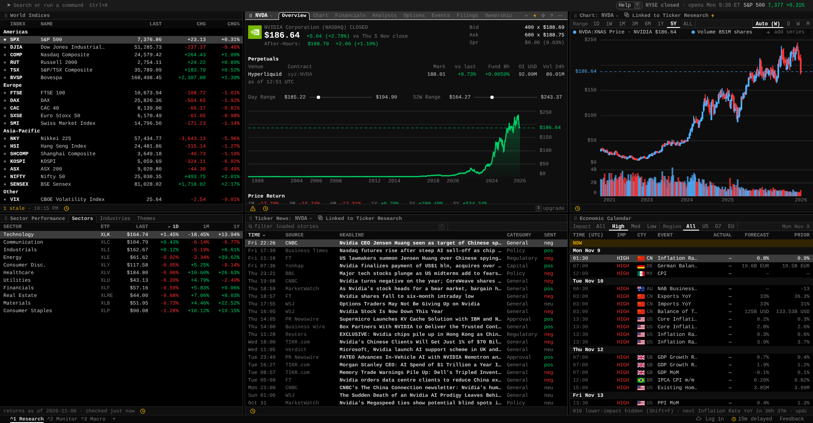

<div align="center">
  
  <h1>Apex Stock Terminal</h1>
  <p>A keyboard-driven workspace for market research, charts, news, and portfolio analysis.</p>
  <p><a href="https://apex-stock-terminal.vercel.app"><strong>Open the terminal</strong></a> · <a href="https://github.com/TanishSingh192/apex-stock-terminal/issues">Report an issue</a></p>
</div>



## Features

- Global market indices and sector performance tables.
- Stock research, financial data, price history, and interactive charts.
- Ticker news and an economic calendar.
- Configurable workspaces, watchlists, and portfolio tools.
- A command bar and keyboard shortcuts for fast navigation.

Maintained by [TanishSingh192](https://github.com/TanishSingh192).

## Run locally

Requires **Bun 1.3.14**.

```bash
git clone https://github.com/TanishSingh192/apex-stock-terminal.git
cd apex-stock-terminal
bun install --frozen-lockfile
bun run web:build
bunx wrangler dev --local
```

Open the localhost URL printed by Wrangler. Use **Ctrl+K** to search or run a command, such as `DES NVDA`.

## Deploy on Vercel

The repository includes `vercel.json` and the middleware entrypoint. Import this repository into your Vercel account; the install command, build command, and output directory are configured automatically.

Alternatively, after signing in with the Vercel CLI:

```bash
vercel deploy --prod
```

The build regenerates `middleware.js` from `scripts/vercel-middleware.ts`. It forwards API requests through the app's origin, validates the incoming origin, and normalizes upstream compression headers for the Node runtime.

## Data and hosting

Market data, account services, and certain premium features currently use **Gloom Cloud**, an external service. This repository does not contain that service's proprietary backend. Provider accounts, availability, and subscription requirements still apply; free market data is delayed.

The Vercel build uses periodic HTTP refreshes because this deployment does not relay WebSocket upgrades. Features that require live WebSocket streams need a compatible backend before they can be enabled. Anonymous plugin proxy requests are disabled until a shared rate limiter is configured. Upstream research analytics are disabled on Vercel.

The codebase also includes terminal and desktop clients. The desktop SDK must be installed with `bun run desktop:sync` before desktop development. Apex desktop release feeds and signing credentials need separate setup; desktop packages have not been validated in this deployment.

## Development

```bash
bun run web:audit
bun test src/renderers/vercel/upstream.test.ts src/renderers/cloudflare/worker.test.ts
bun test src/api-client/socket-health.test.ts src/api-client/research-telemetry.test.ts
```

The full contributor guide is in [CONTRIBUTING.md](CONTRIBUTING.md). Historical upstream release workflows are retained in [docs/upstream-workflows](docs/upstream-workflows) as reference and do not run in this repository.

## License and provenance

Released under the [MIT license](LICENSE). Apex Stock Terminal builds on the MIT-licensed Gloomberb project and includes custom branding, deployment configuration, and Vercel transport fixes. Original copyright notices are preserved. See [THIRD_PARTY_NOTICES.md](THIRD_PARTY_NOTICES.md) for the source reference.
